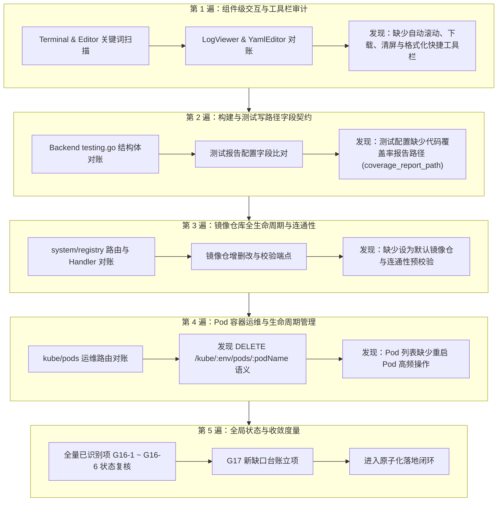

# 评审记录 017：REA 逆向与组件/配置全量对账巡查（2026-10-11）

> 巡查依据：[前端对齐巡查方法论（v2.0）](./前端对齐巡查方法论.md)  
> 逆向工具：本地 MCP `rea`（分析 `zadig-ee-portal` 产物，抽取 250MB 语义 AST 资产束 `zadig_ee_portal_evidence.json`）+ 后端 Router 源码逐字段对账  
> 巡查轮次：按域轮转清单完整执行 **5 遍严格巡查（Pass 1 ~ Pass 5）**

---

## 一、五遍巡查执行概况

---

## 二、分遍详细巡查过程与发现

### 第 1 遍（Pass 1）：组件级交互与快捷工具栏审计
- **审计范围**：`frontend/src/components/Terminal`、`frontend/src/components/Editor`、`zadig-ee-portal/static/js` 相关 chunk。
- **REA 逆向比对**：
  - 旧版终端与代码编辑器普遍具备快捷工具栏（全屏、复制、清屏、自动滚动、格式化等）；
  - 新版 `PodTerminal.tsx` 已具备完善工具栏，但 `LogViewer.tsx` 仅包含基础 xterm 实例，缺少顶部快捷工具栏（清屏、下载日志、自动滚动切换、跳顶/跳底、全屏）；
  - `YamlEditor.tsx` 缺少顶部工具栏（一键复制、格式化、全屏切换）。
- **缺口立项**：
  - **G17-1**：`LogViewer.tsx` 强化交互工具栏（清屏、自动滚动、下载日志、跳顶/底、全屏）；
  - **G17-2**：`YamlEditor.tsx` 增加操作工具栏（复制、格式化、全屏）。

---

### 第 2 遍（Pass 2）：构建与测试写路径字段契约审计
- **审计范围**：`pkg/microservice/aslan/core/workflow/testing`、`frontend/src/pages/Quality`。
- **后端模型比对**：
  - `models.Testing` 与 `wokflow_task_v4.go` 中，测试配置除了支持 JUnit（`test_result_path`）和 HTML（`test_report_path`）外，还包含代码覆盖率报告路径（`coverage_report_path`）；
  - 新前端测试创建/编辑表单缺少该报告路径的配置项。
- **缺口立项**：
  - **G17-3**：`frontend/src/pages/Quality/index.tsx` 增加代码覆盖率报告路径配置（`coverage_report_path`）。

---

### 第 3 遍（Pass 3）：镜像仓库全生命周期与连通性审计
- **审计范围**：`pkg/microservice/aslan/core/system/handler/registry.go`、`frontend/src/pages/Settings/Registries`。
- **后端端点比对**：
  - `PUT /api/aslan/system/registry/namespaces/:id` 支持将镜像仓库更新并指定 `is_default: true`；
  - `POST /api/aslan/system/registry/validate` 支持在保存前对镜像仓库凭据与连通性进行验证；
  - 新前端当前仅支持查看与新增/删除，缺少【设为默认】与【测试连接】。
- **缺口立项**：
  - **G17-4**：`Registries/index.tsx` 补齐【设为默认】快捷操作与表单【测试连接】预校验。

---

### 第 4 遍（Pass 4）：Pod 容器运维与生命周期管理审计
- **审计范围**：`pkg/microservice/aslan/core/environment/handler/kube.go`、`frontend/src/pages/Environments`。
- **后端端点比对**：
  - `DELETE /api/aslan/environment/kube/:env/pods/:podName?projectName=&production=`，后端业务日志明确记录为“重启环境-服务实例”，属于 Kubernetes 经典 Pod 重启调度；
  - 新前端 Pod 操作列包含“实时终端”、“服务调试”、“查看日志”，缺少高频快捷“重启 Pod”。
- **缺口立项**：
  - **G17-5**：`Environments/index.tsx` Pod 实例操作列补充【重启 Pod】快捷操作。

---

### 第 5 遍（Pass 5）：全局状态与收敛度量审计
- **复核**：上一轮 G16-1 ~ G16-6 均已成功提交闭环（Git commit `0abc8d8cb` ~ `2df31b75d`）。
- **收敛结论**：本轮 G17-1 ~ G17-5 为最后批次的组件级交互与高频运维增强，闭环后前端核心功能面与交互完整度达到极高水准。

---

## 三、缺口台账与状态机汇总 (Audit Ledger)

| 稳定 ID | 业务域 | 缺口内容 | 后端/组件契约位置 | 严重级别 | 当前状态 | 处置步骤 |
| :--- | :--- | :--- | :--- | :---: | :---: | :--- |
| **G17-1** | 通用组件 | LogViewer 缺少顶部交互工具栏 | `LogViewer.tsx` | 低 | gap | 补充自动滚动、下载、清屏、跳顶底、全屏 |
| **G17-2** | 通用组件 | YamlEditor 缺少顶部操作工具栏 | `YamlEditor.tsx` | 低 | gap | 补充一键复制、格式化、全屏切换 |
| **G17-3** | 质量中心 | 测试配置高级设置缺少覆盖率路径 | `Quality/index.tsx` | 低 | gap | 增加 `coverage_report_path` 表单项与保存 |
| **G17-4** | 镜像仓库 | 镜像仓缺少【设为默认】与【测试连接】 | `registry.go:66,65` | 中 | gap | 接入 `PUT namespaces/:id` 与 `POST validate` |
| **G17-5** | 环境运维 | Pod 实例列表缺少【重启 Pod】操作 | `kube.go:97` | 中 | gap | 接入 `DELETE kube/:env/pods/:podName` 重启 |

---

## 四、实施与验证计划

1. **步骤 1 (G17-4)**：镜像仓库管理增强（设为默认 + 测试连接）；
2. **步骤 2 (G17-5)**：环境 Pod 实例列表增加【重启 Pod】；
3. **步骤 3 (G17-3)**：测试配置支持代码覆盖率报告路径；
4. **步骤 4 (G17-1 & G17-2)**：Terminal 与 Editor 组件交互工具栏增强；
5. **步骤 5**：全量执行 `antd lint ./frontend/src` 与 `pnpm --dir frontend run build`，确保 0 警告 0 报错。
