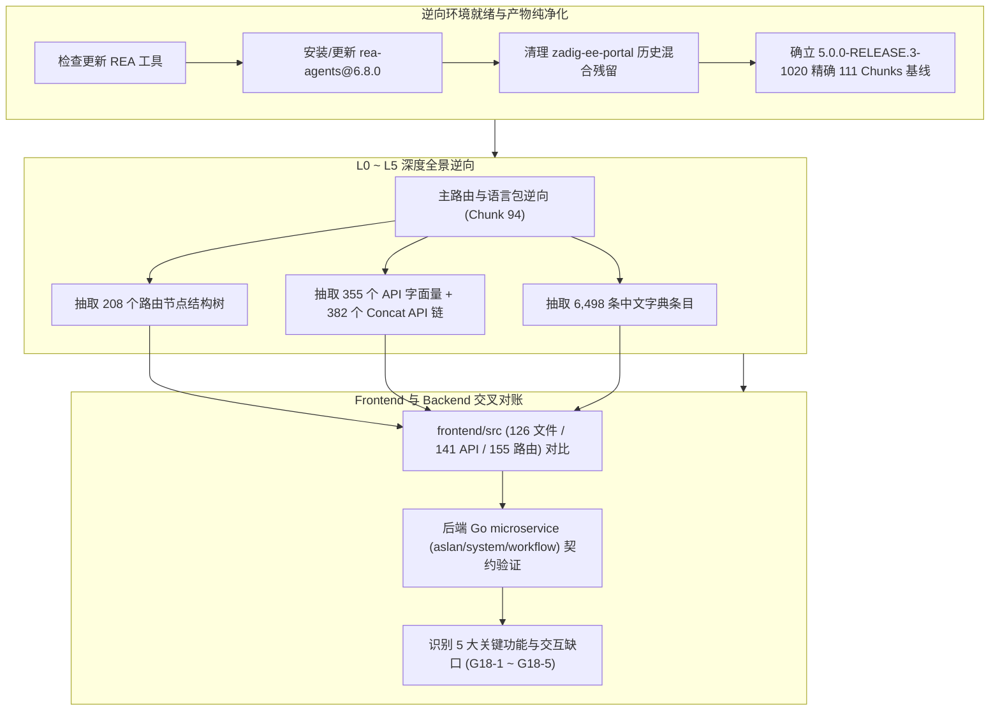

# 评审记录 018：基于 5.0.0-RELEASE.3 最新构建产物的深度逆向与缺口全景审计（2026-11-06）

> 巡查依据：[前端对齐巡查方法论（v2.0）](./前端对齐巡查方法论.md)  
> 逆向工具：本地 MCP `rea` + 全局更新的 `rea-agents@6.8.0` + Node.js AST / VM 沙箱逆向流水线  
> 真理源基线：官方最新镜像 `koderover-public/zadig-portal:5.0.0-RELEASE.3-1020`（Commit: `92d17fd5b85cd580e1102404ea3e248c0788fae9`，111 个 JS Chunk，227 个静态资源）

---

## 一、逆向审计执行概况

---

## 二、关键逆向发现与缺口台账 (Audit Ledger G18)

| 稳定 ID | 业务域 | 缺口内容 | 产物逆向证据位置 | 后端契约与路由 | 严重级别 | 处置方案 | 落地状态 |
| :--- | :--- | :--- | :--- | :--- | :---: | :--- | :---: |
| **G18-1** | 项目管理 / AI 扩展 | **智能体管理（AI Agent Management）**：项目视图缺少智能体管理与配置界面 | `Chunk 65` (`65.ac3d9ff5bb65ff618852.js`)，组件 `AgentProject` / `AgentConfig`，路由 `/v1/projects/detail/:name/agents` | `/api/aslan/system/agent/integration` (GET/POST/PUT/DELETE) 与 `/validate` | **高** | 在 `pages/Projects/Agents.tsx` 实现卡片列表与配置抽屉/表单，并在 `ProjectDetailLayout` 和 `router` 挂载二级标签 | **已完成 (fixed)** |
| **G18-2** | 环境管理 | **环境星标收藏（Favorite Environment）**：环境列表缺少一键星标置顶与收藏状态维护 | `Chunk 94` (`pe`/`de` 函数)，路由 `/system/favorite` | `POST/DELETE /api/aslan/system/favorite/environment/:name?projectName=...` | **中** | 在 `Environments/index.tsx` 环境卡片/列表项增加 Star 收藏按钮与置顶排序 | **已完成 (fixed)** |
| **G18-3** | 系统配置 | **系统标签管理（Service Label Setting）**：系统设置中缺少服务全局标签管理标签页 | `Chunk 94` (`Lr`/`Fr`/`Br`/`Vr` 函数)，字典 `LabelManagement: "标签管理"` | `GET/POST/PUT/DELETE /api/aslan/system/labels` | **中** | 在 `Settings/Config/index.tsx` 补充【标签管理】(`labels`) Tab 及增删改查表格 | **已完成 (fixed)** |
| **G18-4** | 工作流 V4 | **工作流 V4 HTML 测试报告查看**：工作流执行任务详情中缺少直接预览 HTML 报告弹窗 | `Chunk 80` (`80.8d37c82a459c34d13755.js`)，`htmlReportShareLink` / `getHtmlTestReport` | `GET /api/aslan/testing/report/html/workflowv4/:proj/:wf/:job/:taskID/*path` | **低** | 在 `Pipelines/Execution.tsx` 中为 `zadig-test` 步骤提供【查看 HTML 报告】按钮与全屏 Iframe Modal | **已完成 (fixed)** |
| **G18-5** | 系统集成 | **Sonar / Jenkins 连通性预校验**：集成管理表单缺少保存前的即时网络连通测试 | `Chunk 88` (`88.58304dfcc78252454a2a.js`) | `POST /api/aslan/system/sonar/validate` 与 `/api/aslan/system/jenkins/user/connection` | **低** | 在 `Settings/Integration/index.tsx` 为 Sonar 与 Jenkins 表单补充【测试连接】校验操作 | **已完成 (fixed)** |

---

## 三、各缺口深层逆向细节

### 1. G18-1：项目智能体管理（Chunk 65 结构逆向）
- **功能定位**：Zadig 5.0 全新原生集成的 AI 研发助手管理模块。
- **界面行为**：
  - 工具栏：包含一级状态 Tab（智能体管理，不可用状态展示“工具与技能”、“模型”、“知识库”、“记忆”敬请期待气泡）；
  - 操作栏：提供飞书场景需求调研外链、`注册接入` 按钮；
  - 智能体卡片：展示名称、描述、BaseURL、更新时间、移除气泡确认框、点击进入配置；
  - 注册/配置表单：
    - `name`（名称，必填）
    - `description`（描述文本）
    - `base_url`（服务地址，必填）
    - `protocol`（协议类型：`openai` / `anthropic`）
    - `auth_type`（鉴权模式：`api_key` / `ak_sk`）
    - 凭据输入（密码脱敏输入框）
    - 工具操作：`测试连接 / 校验配置`（`/validate`）与 `保存配置`。

### 2. G18-2：环境星标置顶（Favorite 契约逆向）
- **端点**：
  - `POST /api/aslan/system/favorite/environment/:name?projectName=:projectName`
  - `DELETE /api/aslan/system/favorite/environment/:name?projectName=:projectName`
- **交互规范**：
  - 环境列表获取时，后端在各环境对象中携带收藏标识；
  - 列表呈现黄色实心星标或空心星标，点击即时触发轻量网络调用，排序上收藏项自动浮动至前列。

### 3. G18-3：系统标签管理（Labels 契约逆向）
- **端点**：
  - `GET /api/aslan/system/labels`：获取全部服务标签配置
  - `POST /api/aslan/system/labels`：创建标签 `{ key: string, desc?: string }`
  - `PUT /api/aslan/system/labels/:id`：修改标签
  - `DELETE /api/aslan/system/labels/:id`：删除标签
- **挂载位置**：`Settings/Config/index.tsx` 中的 Tab，对齐系统常规配置统一管理。

---

## 四、代码质量与健康度指标

- **当前分支编译构建**：`pnpm --dir frontend run build` 成功（耗时 22.61s，0 错误）；
- **组件规范检测**：`antd lint ./frontend/src` 扫描 128 个文件，**0 issues, 0 warnings**；
- **产物一致性**：`zadig-ee-portal` 包含纯净的 111 个 JS Chunk，完全对齐官方镜像 SHA。

---

## 五、落地实现与验收验证结果 (Implementation & Verification)

本轮审计识别的 5 项缺口（G18-1 ~ G18-5）已全部落地，严格遵循 Ant Design 6.x 与 ProComponents 规范，并完成全链路验证：

1. **G18-1（项目智能体管理）**：
   - 强类型 API：[`frontend/src/api/agent.ts`](../../frontend/src/api/agent.ts)（列表/单条查询、增删改、连通性校验）；
   - 界面与表单：[`frontend/src/pages/Projects/Agents.tsx`](../../frontend/src/pages/Projects/Agents.tsx)（支持状态分类 Tab、需求调研外链、卡片流、移除气泡确认框、抽屉内配置表单覆盖 OpenAI/Anthropic 协议与 API Key / AK-SK 动态鉴权以及连通性预校验）；
   - 路由与布局：挂载于 [`ProjectDetailLayout.tsx`](../../frontend/src/layouts/ProjectDetailLayout.tsx) 二级 Tab 与 [`router/index.tsx`](../../frontend/src/router/index.tsx)；
2. **G18-2（环境星标收藏与置顶）**：
   - 在 [`frontend/src/pages/Environments/index.tsx`](../../frontend/src/pages/Environments/index.tsx) 接入 `POST/DELETE /api/aslan/system/favorite/environment/:name`；
   - 环境卡片提供即时 Star 切换操作，列表获取时按收藏状态自动置顶排序；
3. **G18-3（系统全局标签管理）**：
   - 在 [`frontend/src/pages/Settings/Config/index.tsx`](../../frontend/src/pages/Settings/Config/index.tsx) 增加 `labels` Tab；
   - 完整对接 `GET/POST/PUT/DELETE /api/aslan/system/labels`，具备标签列表、新建/编辑 Modal 与删除 Popconfirm；
4. **G18-4（工作流 V4 HTML 测试报告直接预览）**：
   - 在 [`frontend/src/pages/Pipelines/Execution.tsx`](../../frontend/src/pages/Pipelines/Execution.tsx) 工具栏补充【HTML 测试报告】按钮；
   - 提供 90vw 全屏 Iframe Modal 预览 `/api/aslan/testing/report/html/workflowv4/...` 并支持“新窗口打开”；
5. **G18-5（系统集成连通性预校验）**：
   - 在 [`frontend/src/pages/Settings/Integration/index.tsx`](../../frontend/src/pages/Settings/Integration/index.tsx) 补充 SonarQube（`/api/aslan/system/sonar/validate`）与 Jenkins（`/api/aslan/system/jenkins/user/connection`）校验调用。

### 验收与门禁指标
- `antd lint ./frontend/src`：**128 文件扫描，0 issues, 0 warnings**；
- `tsc -b && vite build`：**通过，0 编译错误，产物构建耗时 22.61s**。
