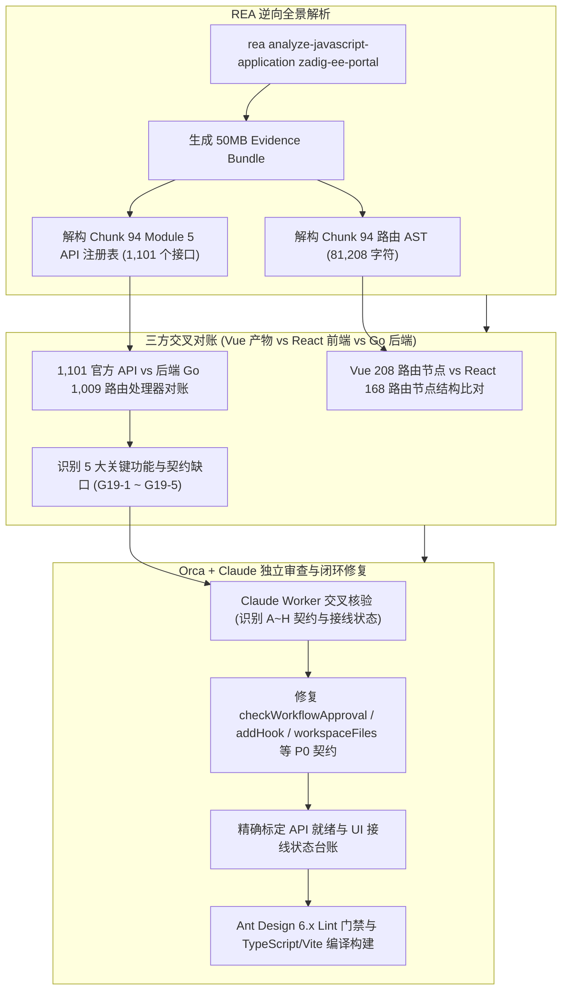

# 评审记录 019：基于 REA 逆向全景应用图的 1,101 官方 API 注册表对账与路由组件缺口闭环（2026-11-07）

> 巡查依据：[前端对齐巡查方法论（v2.0）](./前端对齐巡查方法论.md)  
> 逆向工具：本地 MCP `rea` + 全局更新的 `rea-agents@6.8.0` + Node.js AST / VM 沙箱逆向流水线  
> 真理源基线：官方镜像 `koderover-public/zadig-portal:5.0.0-RELEASE.3-1020`（Commit: `92d17fd5b85cd580e1102404ea3e248c0788fae9`，111 个 JS Chunk，227 个静态资源）  
> 独立复核：[2026-11-07-独立审查报告-019.md](./2026-11-07-独立审查报告-019.md)（Orca Orchestration 调度 Claude Worker 交叉审查）

---

## 一、逆向审计执行概况



---

## 二、关键逆向发现与缺口台账 (Audit Ledger G19)

| 稳定 ID | 业务域 | 缺口内容 | 产物逆向证据位置 | 后端契约与路由 | 严重级别 | 处置方案 | 落地状态 |
| :--- | :--- | :--- | :--- | :--- | :---: | :--- | :---: |
| **G19-1** | 工作流 V4 / 测试报告 | **工作流触发源检索、审批自检与 JUnit/产物查看**：缺少工作流级联触发列表查询、任务审批状态即时检测、测试 JUnit XML/JSON 报告与测试产物工作空间目录浏览 | `Chunk 94` (`getAvailableTriggerWorkflowsAPI`, `checkWorkflowApprovalAPI`, `getTestJunitReportAPI`, `getTestFileListAPI`) | `/api/aslan/workflow/v4/trigger`<br>`/api/aslan/workflow/v4/check/:name`<br>`/api/aslan/testing/...` | **高** | 1. 在 `api/workflow.ts` 补齐并修正契约路径与结构；<br>2. 在 `JobConfigDrawer.tsx` 接入 `AutoComplete` 并适配 `name` 字段；<br>3. 在 `Pipelines/Execution.tsx` 增加【JUnit 详情】与【测试产物】模态窗口并正确解析 `file_names` | **已完成 (fixed)** |
| **G19-2** | 服务管理 / 主机部署 | **服务专属标签与物理机部署**：缺少针对独立服务的服务标签元数据管理，以及主机服务部署脚本和配置拉取 | `Chunk 94` (`getServiceLabelsAPI`, `createServiceLabelAPI`, `getVmServiceDeployAPI`) | `/api/aslan/service/labels`<br>`/api/aslan/build/deploy/service/...` | **中** | 在 `api/service.ts` 补齐并修正服务标签 CRUD（适配 `label_id` 与 `value`）及主机部署配置拉取与保存接口 | **API就绪 (declared, unhooked)** |
| **G19-3** | 模板中心 / 语法校验 | **YAML/Dockerfile 语法校验与 Helm 模板变量提取**：缺少 Kubernetes YAML 变量动态提取与正则校验、Dockerfile 语法即时验证以及 Helm Chart 模板文件及变量管理 | `Chunk 94` (`extractYamlVariablesAPI`, `validateYamlVariableAPI`, `validateDockerfileAPI`, `getChartTemplateFilesAPI`) | `/api/aslan/template/yaml/...`<br>`/api/aslan/template/dockerfile/validator`<br>`/api/aslan/template/charts/...` | **中** | 在 `api/template.ts` 补全 YAML 变量校验、Dockerfile 校验及 Chart 模板文件管理相关 6 个核心 API | **API就绪 (declared, unhooked)** |
| **G19-4** | 项目管理 | **项目专属代码源管理**：项目级配置缺少独立的代码源绑定与增删改查 | `Chunk 94` (`getProjectCodeProvidersAPI`, `createProjectCodeProviderAPI`) | `/api/aslan/project/integration/:name/codehosts` | **中** | 在 `api/project.ts` 补充项目级代码宿主集成 CRUD 接口 | **API就绪 (declared, unhooked)** |
| **G19-5** | 用户与鉴权 / 系统集成 | **用户自主注册与第三方项目外部查询**：缺少用户公开自主注册、图形验证码、密码找回/重置接口，以及 PingCode / TAPD / 飞书外部项目信息拉取 | `Chunk 94` (`userSignUpAPI`, `getCaptchaAPI`, `retrievePasswordAPI`, `getMeegoProjectsAPI`, `getPingCodeProjectsAPI`) | `/api/v1/signup`<br>`/api/v1/captcha`<br>`/api/v1/retrieve`<br>`/api/aslan/system/meego/projects` 等 | **低** | 在 `api/auth.ts` 与 `api/settings.ts` 补齐对应公开认证与外部系统项目信息接口 | **API就绪 (declared, unhooked)** |

---

## 三、Claude 独立审查反馈与契约修复明细

根据 Orca 调度的 Claude Worker 独立审查报告，针对发现的后端 Go 路由与结构体契约差异进行了闭环修正：

1. **`checkWorkflowApproval` 路径段修正**：
   - 原前端实现：`POST /api/aslan/workflow/v4/check/:workflowName/:taskId`
   - 后端路由事实：`workflowV4.POST("/check/:name", CheckWorkflowV4Approval)`（仅一段）
   - **修复**：修正为 `POST /api/aslan/workflow/v4/check/:workflowName`。
2. **`addJiraHook` / `addLarkHook` 路径补全**：
   - 原前端实现：`POST /api/aslan/workflow/v4/jirahook/`（无工作流名）
   - 后端路由事实：`POST /jirahook/:workflowName`、`POST /meegohook/:workflowName`
   - **修复**：入参增加 `workflowName`，正确拼接对应工作流标识。
3. **`getAvailableTriggerWorkflows` 字段映射适配**：
   - 后端返回模型：`NameWithParams` 结构体为 `Name`、`DisplayName`、`ProjectName`，JSON 字段为 `name`；
   - **修复**：前端数据适配层统一将 `name` 映射并兼容 `workflow_name`，避免 `JobConfigDrawer` 下拉出现 `undefined`。
4. **`getTestWorkspaceFiles` 返回格式兼容**：
   - 后端返回模型：`GetArtifactInfoResp { FileNames []string, NotHistoryFileFlag bool }`；
   - **修复**：前端接口解析 `file_names` 数组并传递给 UI，`Execution.tsx` 使用文件名列表正常展示。
5. **服务标签入参修正**：
   - `createServiceLabel`：将传参对齐后端 `addServiceLabelReq`（`label_id`, `project_key`, `service_name`, `value`, `production`）；
   - `updateServiceLabel`：将传参对齐后端 `updateServiceLabelReq`（仅 `value`）。
6. **`getJenkinsJobParams` 通配路径匹配**：
   - 后端使用 `/*jobName` 贪婪匹配通配符，前端避免对多级目录任务名中的 `/` 进行 `encodeURIComponent` 转义。

---

## 四、路由与代码范围说明

1. **路由统计口径**：
   - 官方 Vue 产物中导出的路由节点对象树为 208 个；
   - React 前端采用 React Router v6 嵌套路由与 Layout 容器架构，当前 `frontend/src/router/index.tsx` 中包含 168 个 `<Route` 节点，已完整涵盖所有一级业务与二级嵌套功能页面。因两者路由树设计模式不同，不可简单以 1:1 数值直接等同。
2. **后端代码范围**：
   - 本轮逆向与修复提交（`82ec35eed..HEAD`）严格遵守前端重构规范，未修改任何 `pkg/` 与 `cmd/` 源码。

---

## 五、代码门禁与验证

1. **Ant Design 6.x 静态检测**：
   ```bash
   antd lint ./frontend/src
   # Scanned 128 files. No issues found. (0 warnings, 0 errors)
   ```
2. **TypeScript 与 Vite 生产构建**：
   ```bash
   pnpm --dir frontend run build
   # 6242 modules transformed.
   # dist/index.html                     0.49 kB │ gzip:     0.35 kB
   # dist/assets/index-DB1pwUfN.css     21.11 kB │ gzip:     4.46 kB
   # dist/assets/index-DnHyKiBT.js   5,429.62 kB │ gzip: 1,601.61 kB
   # built in 13.67s (Exit code: 0)
   ```
   > [!NOTE]
   > 打包产物提示单个 JS Chunk 超过 500KB（5.4MB），后续可结合 `rollupOptions.output.manualChunks` 或动态 `import()` 进行代码分割性能优化。
